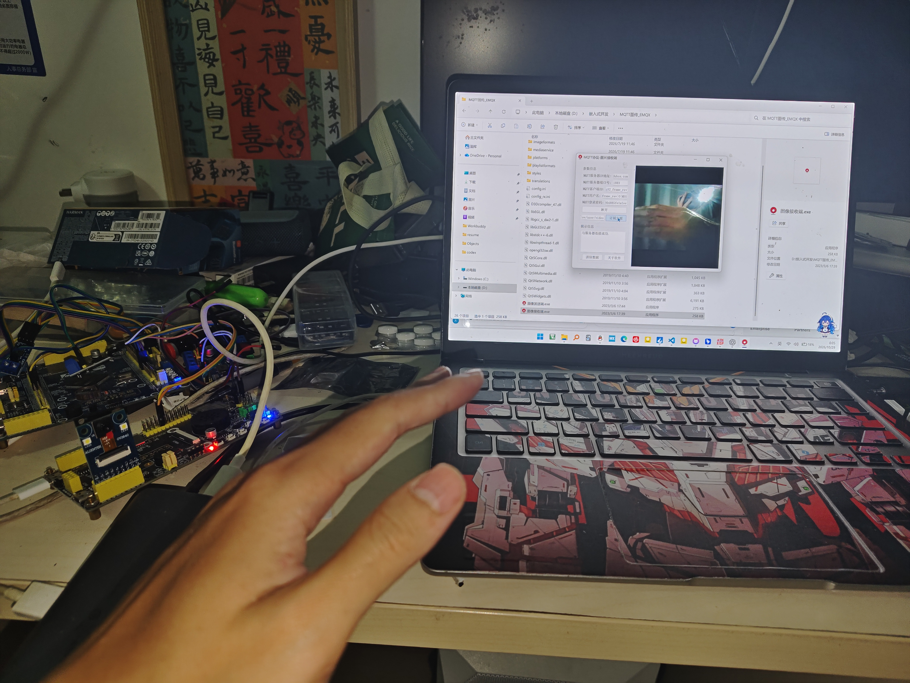
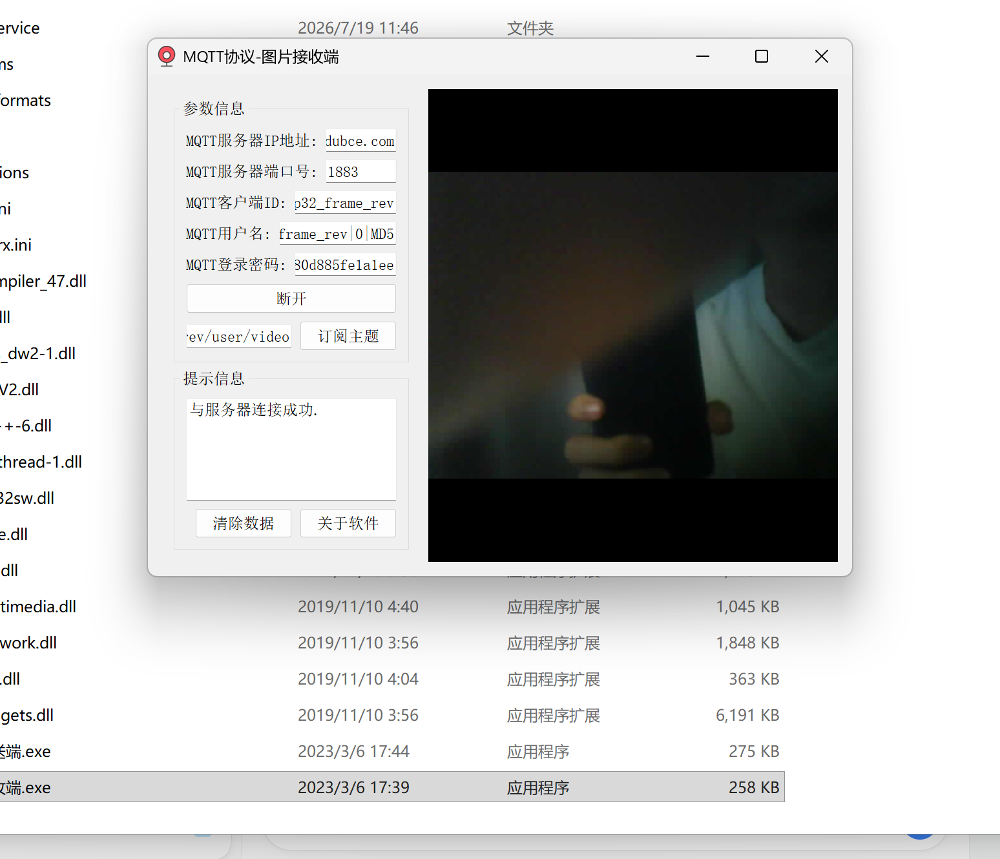

# 图传实物验证

本目录汇总项目维护者提供的 MQTT 图传接收截图、实物照片和演示视频。资料于 2026-10-29 收入仓库，反映摄像头图像经 MQTT 到达 PC 接收工具并显示的演示场景。

## 实物照片

画面展示开发板、摄像头连接及 PC 接收窗口。

[打开原始照片](../../验证2.jpg)

## PC 接收截图

截图中可见 MQTT 图像接收端、连接成功提示及接收画面。

[打开原始截图](../../验证1.png)

## 演示视频

[打开或下载 MQTT 摄像头验证视频](../../mqtt摄像头验证.mp4)

文件为 MP4，元数据显示 1920 × 1080、时长约 4.965 秒、大小约 6.92 MiB。它用于保存本次实物演示，不作为持续运行时长、端到端延迟或实际帧率的量化测试结果。

两张图片和视频均按维护者要求原样保留，没有重绘、裁剪或重新编码。

## 验证工具与复现入口

- [第三方 MQTT 图传工具说明及下载](../../tools/mqtt-image-validator/README.md)
- [业务架构与数据流规范](../业务架构与数据流规范.md)
- [视频与 CAN 并行运行的 ISO-TP 联调修订](../../verification/2026-10-28-isotp/检查结果.md)

PC 图传工具为第三方软件，作者和许可信息尚未核实；本项目不将其列为自主开发的软件。
