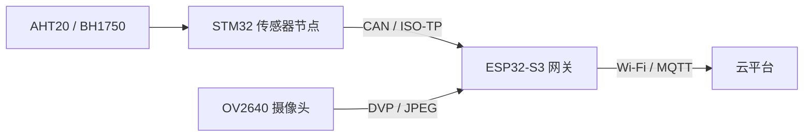

# 智能家居系统业务架构与数据流规范

| 文档属性 | 内容 |
| --- | --- |
| 文档编号 | SHG-ARCH-001 |
| 版本 | 1.1 |
| 更新日期 | 2026-10-28 |
| 适用系统 | STM32 传感器节点、ESP32-S3 视频与云接入网关 |
| ESP32 实现基线 | 首次基线 `9455708`，含本地 ISO-TP 集成修订，见下文 |
| 替代资料 | 原《业务职责分工&数据流向》4 页演示文稿 |

## 1. 目的与范围

本规范定义系统分层、模块职责、任务调度、数据传输路径和缓冲区所有权，供开发、联调及维护使用。

系统包含两条上行链路：

- **视频链路**：ESP32-S3 采集 OV2640 JPEG 图像，封装为 Base64 JSON，通过 MQTT 上传。
- **传感器链路**：STM32 采集 AHT20 温湿度与 BH1750 光照度，经 CAN ISO-TP 传输到 ESP32-S3，再通过 MQTT 上传。

ESP32 章节描述上述代码基线的实际实现。STM32 章节定义节点侧设计约定，其代码不在本仓库中，实施状态由对应节点工程确认。涉及传感器单位、数据布局、采样周期的约定应由两端共同维护。

本规范使用“必须”表示接口或资源使用的强制约束，使用“应”表示推荐做法。设计约定与已实现行为分开标注。

## 2. 系统组成与分层规则



| 层级 | 职责 | 边界 |
| --- | --- | --- |
| 应用层 `App` | 决定采集、发送与上传的时机，维护业务状态和调度策略 | 不直接实现寄存器操作、ISO-TP 分包或 Base64 算法 |
| 服务层 `Svc` | 管理共享资源与数据生命周期，封装编码、协议与通信服务 | 通过 BSP 或厂商组件访问硬件；对应用层暴露稳定接口 |
| 板级支持层 `Bsp` | 封装硬件初始化、引脚、总线和设备操作 | 不决定云端上传策略或业务采样周期 |

视频采集控制必须经 `Svc_Video` 进入 `VIDEO`，以保持帧池和设备生命周期一致。应用层可通过 BSP 接口读取按键、更新 LED。模块调用方向与数据传输方向应分别理解，例如上传任务调用编码服务，但编码结果返回上传任务继续发布。

## 3. ESP32-S3 模块职责

### 3.1 应用层

| 模块 | 职责 | 主要接口或协作对象 |
| --- | --- | --- |
| `App_Video_Streaming` | 维护视频业务状态机，触发打开、开始、取帧、停止及异常恢复；控制采集循环的名义间隔 | `Svc_Video_Ctrl`、`Svc_Video_Start`、`Svc_Video_Frame_Ready`、`Svc_Video_Stop` |
| `App_Video_Streaming_Switch` | 读取按键事件，切换视频开始/停止状态，触发初始化与待机 | `Key_Get_State`、`Svc_Video_Init` |
| `App_Sensor_Sync` | 轮询 ISO-TP，接收完整传感器报文，检查长度并按值入队 | `Svc_Isotp_Poll`、`Svc_Isotp_Receive`、传感器队列 |
| `App_Cloud_Upload` | 分别运行视频上传与传感器上传任务，决定本地上传节奏及 JSON 载荷 | `Svc_Video_Frame_Hold/Release`、`Svc_Encode_Base64`、`Svc_Mqtt` |

`App_Cloud_Upload` 是业务模块名称，其内部存在两个独立任务，不是由一个循环串行处理所有数据。

### 3.2 服务层

| 模块 | 职责 | 资源与约束 |
| --- | --- | --- |
| `Svc_Video` | 初始化摄像头服务和帧池；协调取帧、持帧、归还、关闭与复位 | 独占管理空闲/就绪队列、帧所有权、状态锁和控制锁 |
| `Svc_Encode_Base64` | 对有效 JPEG 载荷进行 Base64 编码，并生成视频 JSON | 检查输入长度、输出容量及编码结果；不创建独立任务 |
| `Svc_Isotp` | 创建 TWAI 节点与 ISO-TP 传输实例，封装发送、轮询与接收 | 使用 ESP-IDF TWAI 接口和本地修订的 `esp_isotp` 组件 |
| `Svc_Mqtt` | 启动 Wi-Fi 与 MQTT 客户端，注册 MQTT 事件，订阅主题并封装发布 | Wi-Fi 事件由 BSP 处理；MQTT 重连使用客户端默认机制；应用层尚无补发队列 |

`Svc_Isotp` 当前由应用任务轮询接收完整报文，没有向 `App_Sensor_Sync` 注册“完整报文回调”。底层驱动的中断处理不等于应用任务在 ISR 中运行。

### 3.3 板级支持层与厂商组件

| 模块 | 职责 |
| --- | --- |
| `VIDEO` | 封装视频设备初始化、格式设置、V4L2 缓冲申请与映射、开关流、取帧复制、缓冲归还及清理 |
| `WIFI_CONNECT` | 初始化 Wi-Fi STA、连接接入点、处理获得 IP 与断线重试事件 |
| `LED` | 提供指示灯初始化、状态设置与翻转接口 |
| `KEY` | 经 XL9555 读取按键，执行按键识别与消抖 |
| `XL9555` | 提供 IO 扩展器初始化、方向配置和读写接口 |
| `esp_video`、`esp_cam_sensor`、`example_video_common` | 提供厂商视频框架、传感器驱动及板级公共配置 |

OV2640 的传感器寄存器与格式配置主要由厂商摄像头组件实现，不能将 `VIDEO` 模块简单等同为 OV2640 寄存器驱动。

## 4. STM32 节点模块职责（设计约定）

| 层级 | 规范名称 | 职责 |
| --- | --- | --- |
| App | `App_DataCollection` | 决定温湿度和光照度采样周期，组织一次传感器快照；滤波策略由节点工程定义 |
| App | `App_DataTx` | 从传感器队列读取数据，决定发送时机及发送内容 |
| Svc | `Svc_DataCollect_Process` | 调用传感器驱动，向应用层返回采集结果 |
| Svc | `Svc_Isotp` | 按 ISO-TP 完成应用报文分包、接收处理及发送状态管理 |
| Svc | `Svc_CanIf`（可选适配层） | 当节点工程设置该层时，封装 CAN 原始帧接口；未设置时由 ISO-TP 适配代码调用 BSP |
| Bsp | `BSP_AHT20` | 驱动 AHT20，获取温度与相对湿度 |
| Bsp | `BSP_BH1750` | 驱动 BH1750，获取光照度 |
| Bsp | `BSP_I2C` | 提供软件 I2C 时序与设备访问 |
| Bsp | `BSP_CAN` | 封装 CAN 控制器寄存器及原始帧收发 |

BH1750 是光照传感器。采样周期归应用层管理，传感器驱动仅执行设备操作。节点工程应统一 `BSP_CAN` 与历史名称 `BSP_MyCAN`，不得将别名误认为两个独立 CAN 驱动。

## 5. 视频链路与帧所有权

### 5.1 数据路径


1. 采集任务调用 `Svc_Video_Frame_Ready`，服务层从空闲队列取得应用帧缓冲。
2. 若空闲队列为空，服务层可复用尚未被上传任务持有的最旧就绪帧，以优先保留较新画面。
3. `VIDEO` 从驱动取出 V4L2 缓冲，检查索引与长度，将 JPEG 复制到应用帧缓冲，然后立即归还 V4L2 缓冲。
4. 取帧成功后，服务层把应用帧指针放入就绪队列。取帧失败时归还空闲队列，不向上传任务发布失败帧。
5. 上传任务经 `Svc_Video_Frame_Hold` 获得帧，调用编码函数并同步调用 MQTT 发布接口。
6. 编码或发布处理结束后，由持帧任务调用 `Svc_Video_Frame_Release`。成功归还后，调用方帧指针置为 `NULL`。

驱动 V4L2 缓冲与应用层帧池是两组不同资源。驱动缓冲的归还发生在复制结束后；应用帧的归还发生在上传任务结束本轮使用后。

### 5.2 资源约束

| 项目 | 当前值或策略 |
| --- | --- |
| 图像格式与尺寸 | JPEG，640 × 480 |
| 名义采集间隔 | 40 ms，按 `VIDEO_MAX_FRAME_RATE = 25` 计算 |
| 应用帧池 | 6 个缓冲，每个最大 30 KiB，即 30,720 字节 |
| 帧载荷合计 | 184,320 字节，即 180 KiB，不含描述符、队列和驱动缓冲 |
| V4L2 缓冲 | 请求 4 个；必须以驱动实际返回数量和查询长度为准 |
| 驱动图像容量请求 | `sizeimage = 128 * 1024`，不代表每帧有效长度 |
| Base64 最大内容长度 | 40,960 字节 |
| 视频 JSON 编码缓冲 | `MAX_ENCODER_LEN = 40,986` 字节，包含 JSON 包装及结束符 |
| 同时持帧消费者 | 当前仅允许 1 个持帧任务 |
| 控制锁等待、关闭等待 | 各自上限为 2,000 ms，不代表整个关闭流程的统一总时限 |

必须遵守以下所有权规则：

- **VID-01**：仅持帧任务可以归还该帧；其他任务不得代为归还或释放。
- **VID-02**：关闭、反初始化或复位不得在消费者仍持帧时销毁帧池。
- **VID-03**：关闭等待超时时保留资源，等待持帧任务结束使用后再重试。
- **VID-04**：每次成功 `Hold` 必须对应一次成功 `Release`，包括编码失败或消息发布失败的路径。
- **VID-05**：帧索引必须位于实际映射范围内，复制长度必须同时满足实际映射长度和目标帧容量限制。
- **VID-06**：编码失败不得继续拼接或发送无效 JSON。

### 5.3 视频消息

发布主题由 `USE_VIDEO_TOPIC_PUBLISH` 指定。当前 JSON 结构如下，示例中的字符串仅表示字段形态：

```json
{
  "params": {
    "image": "<JPEG 的 Base64 字符串>"
  }
}
```

当前视频发布使用 QoS 0、`retain = 0`。发布函数返回不等于云端已接收。当前应用没有视频断网缓存或失败补发机制。

## 6. 传感器链路与数据接口

### 6.1 STM32 采集与发送路径


节点侧应按不同采样周期更新数据，再由发送任务读取快照。队列中的一份快照可能包含不同采样时刻的数据，不得把发送频率直接作为全部传感器的采样频率。

### 6.2 ESP32 接收与上传路径


接收任务每轮调用 `Svc_Isotp_Poll` 和 `Svc_Isotp_Receive`。仅当收到的应用报文长度等于 `sizeof(Sensor_data_t)` 时入队。上传任务每轮最多取出一条数据，随后休眠 1,000 ms。

传感器队列容量为 12，队列复制 `Sensor_data_t` 的值，不转移调用者缓冲区的所有权。入队不等待：队列满时丢弃新样本、保留旧数据并限频告警，避免阻塞协议轮询。上传任务最多等待 100 ms 取样本，超时本轮不发布。

### 6.3 CAN 与 ISO-TP 参数

| 参数 | ESP32 当前配置 |
| --- | --- |
| 控制器 | TWAI，经典 CAN、标准帧配置 |
| 总线速率 | 1,000,000 bit/s |
| 采样点参数 | `sp_permill = 833`，即 83.3% |
| TX / RX 引脚 | GPIO 3 / GPIO 10 |
| TWAI 发送队列深度 | 8 |
| ISO-TP 接收 ID | `0x717`，宏 `SENSOR_DATA_CANID` |
| ISO-TP 发送 ID | `0x098`，宏 `TWAI_DATA_ID` |
| ISO-TP 收发缓冲容量 | 各 512 字节 |

STM32 发送与接收方向必须与 ESP32 的配置相匹配，包括 ISO-TP 流控交互。应用报文长度必须采用完整 ISO-TP 载荷长度，不能与单个 CAN 帧的数据长度混用。

### 6.4 当前传感器报文布局

当前代码直接接收 `Sensor_data_t` 的结构体字节，尚未使用独立序列化函数。目标 Xtensa 工具链的默认布局已通过 `sizeof` 和成员偏移编译断言核对：

| 字节偏移 | 长度 | 字段 | 表示与含义 |
| --- | --- | --- | --- |
| 0 | 4 | `aht20_data.temperature` | 32 位浮点数，温度，单位约定为 °C |
| 4 | 4 | `aht20_data.humidity` | 32 位浮点数，相对湿度，单位约定为 %RH |
| 8 | 2 | `light` | `uint16_t`，光照度，单位约定为 lx |
| 10 | 2 | 结构体尾部填充 | 不承载业务字段 |
| 合计 | 12 | `Sensor_data_t` | 当前默认 ABI 大小 |

**SEN-01**：使用当前原始结构体方式联调时，两端必须核对小端字节序、浮点表示、结构体大小和偏移。发送端应清零填充字节，接收端不得读取填充字节作为业务数据。

**SEN-02**：不得仅发送三个字段合计的 10 字节并假定当前接收端能够接受。当前接收条件要求完整结构体为 12 字节。

**SEN-03**：后续如变更字段、单位或对齐方式，应制定带版本号的显式报文编码，并同步升级两端。当前接收代码不支持这种新格式。

### 6.5 传感器云端消息

发布主题由 `USE_SENSOR_TOPIC_PUBLISH` 指定。字段名称必须保持兼容：

```json
{
  "reported": {
    "temperature": 25.5,
    "humidity": 60.5,
    "illuminance": 1000
  }
}
```

温度和湿度按一位小数格式化，光照度按整数输出。JSON 缓冲容量为 200 字节；仅在 `snprintf` 成功且输出未截断时发布。当前消息使用 QoS 0、`retain = 0`，不包含设备侧时间戳、采样序号或单位字段。

## 7. 任务调度与执行上下文

### 7.1 ESP32 当前实现

以下栈大小按 ESP-IDF `xTaskCreate` 的字节单位列示。休眠间隔为名义值，实际循环还包含设备访问、编码、网络发布及调度时间。

| 任务或服务 | 优先级 | 栈大小 | 执行节奏与上下文 |
| --- | --- | --- | --- |
| 视频采集 `App_Video_Streaming` | 10 | 20,480 字节 | 运行态每轮休眠约 40 ms；待机、停止、错误及关闭状态使用不同等待时间 |
| 按键切换 `App_Video_Streaming_Switch` | 5 | 4,096 字节 | 每轮末尾休眠 10 ms；按键识别内部包含 5 ms 采样等待，长按会延长本轮 |
| 传感器接收 `App_Sensor_Sync` | 10 | 4,096 字节 | 任务内轮询 ISO-TP，每轮末尾休眠 10 ms |
| 视频上传 `App_Cloud_Video_Frame_Upload` | 10 | 20,480 字节 | 等待有效帧，处理后默认休眠约 40 ms；视频不可用时等待 20 ms 后重试 |
| 传感器上传 `App_Cloud_Sensor_Data_Upload` | 5 | 4,096 字节 | 每轮最多上传一条，随后休眠 1,000 ms |
| Base64 服务 | 无独立任务 | 使用调用者任务栈与编码缓冲 | 在视频上传任务中执行 |
| MQTT / Wi-Fi 事件 | 库或系统管理 | 由对应组件配置 | 在客户端或系统事件上下文处理，不承担完整视频编码工作 |

默认 `CONFIG_FREERTOS_HZ = 1000`。当前视频上传延迟表达式对已转换为 tick 的宏再次执行 `pdMS_TO_TICKS`；在默认配置下结果仍为 40 ms。变更 tick 频率时，必须先统一毫秒与 tick 的转换位置，再核对调度参数。

25 是配置计算值，不是实际采集或云端播放帧率的验收结果。

### 7.2 STM32 节点设计节奏

| 工作项 | 设计值 | 使用说明 |
| --- | --- | --- |
| AHT20 温湿度采样 | 5,000 ms / 次 | 节点应用层控制 |
| BH1750 光照度采样 | 120 ms / 次 | 节点应用层控制 |
| 采集服务处理节奏 | 120 ms / 次 | 不表示每轮都重新读取温湿度 |
| `App_DataTx` 检查或发送任务间隔 | 10 ms / 次 | 不表示每 10 ms 都产生一份新采样数据 |

这些值继承节点侧设计，必须在 STM32 工程中核对。ESP32 当前上传任务每秒最多消费一条传感器消息，持续高于此速率的输入会填满队列；联调时应共同确定发送策略和允许的丢弃行为。

## 8. 启动、视频状态与关闭

### 8.1 启动顺序

`app_main` 按以下顺序执行：

1. 初始化 NVS；遇页耗尽或版本不匹配时擦除并重新初始化。
2. 初始化网络接口与默认事件循环。
3. 调用 `Svc_Mqtt_Start`，执行 Wi-Fi 初始化及首次连接等待，再启动 MQTT 客户端。
4. 初始化 LED、视频服务、按键和 ISO-TP。
5. 等待 3,000 ms，依次创建视频、传感器同步与云上传业务任务。

上述 3,000 ms 等待不是 MQTT 连接成功的确认机制；当前启动接口也没有把 Wi-Fi 最终连接结果返回给应用层。不得用启动日志中的文字代替网络与云端连通性检查。

### 8.2 视频状态语义

| 状态 | 行为 |
| --- | --- |
| `video_idle` | 调用服务层准备设备，等待开始指令；每轮等待 1,000 ms |
| `video_start` | 调用幂等开始接口并尝试取帧；取帧成功清零重试计数，失败累加 |
| `video_stop` | 停止采集流，保留服务和帧池；每轮等待 2,000 ms |
| `video_error` | 停流并请求复位，受 `VIDEO_RESET_MAX_COUNT = 5` 的恢复预算限制；计数不表示已确认成功复位次数 |
| `video_shutdown` | 请求反初始化并关闭指示；每轮等待 5,000 ms |

当前按键 1 按计数交替写入开始/停止状态，首次有效操作请求开始。按键 2 调用 `Svc_Video_Init` 并写入待机状态。初始化接口具有幂等行为，因此不能把按键 2 等同为无条件硬件复位或完整恢复。

完整关闭必须先停止采集、关闭新消费者入口，再等待已持帧者归还。清空就绪队列、释放驱动资源和帧池必须遵循服务层生命周期，不能由上传任务或按键任务绕过服务直接操作。

## 9. 异常处理与可靠性边界

| 场景 | 当前处理或约束 |
| --- | --- |
| 摄像头映射或部分缓冲申请失败 | 回滚已创建资源，保持失败状态 |
| 取帧失败、长度非法或缓冲归还失败 | 不发布为有效帧，按服务约定回收应用帧 |
| Base64 输入非法或编码失败 | 本轮不发布视频 JSON，仍由持帧者归还 |
| 上传任务尚未归还帧时请求关闭 | 最多等待指定关闭等待时间；超时保留资源 |
| 传感器报文长度不匹配 | 不进入上传队列 |
| 传感器队列满 | 非阻塞丢弃新数据并限频告警，不拖延 ISO-TP 轮询 |
| MQTT 订阅事件没有数据指针 | 仅记录事件和消息 ID，不读取空载荷 |
| MQTT 发布失败或 Wi-Fi 断连 | 库和 BSP 执行各自连接处理；应用层无持久缓存、发布确认或补发闭环 |

对“可靠送达”“断线后自动恢复全部业务”“无丢帧”或“固定端到端延迟”的要求，必须另行定义验收条件并补足实现。当前 QoS 0 与本地调用返回值不能证明这些能力。

### 9.1 ISO-TP 并发与异步发送约束

本地集成修订见 [PATCHES](../Components/ThirdParty/esp_isotp/PATCHES.md)。RX 中断仅按值入队原始帧，由任务处理协议状态；发送、接收与轮询通过互斥锁串行化。32 项原始帧队列与第 6 节的 12 项业务样本队列是不同资源。

TWAI 使用异步指针传递。发送帧结构和数据必须保存到 TX-done，不得使用函数返回后失效的栈内存，也不得在发送完成前覆盖。当前使用 9 个持久发送槽，耗尽时拒绝提交；未完成传输时删除接口必须保留资源并返回失败。

`Svc_Isotp_Poll` 检测到 bus-off 时请求控制器恢复，保留节点与 ISO-TP 句柄；恢复不会自动修复接线、供电或 STM32 发送端的故障。协议任务每秒输出一次 `ISOTP_DIAG` 供联调定位。

## 10. 配置与凭据管理

- 硬件默认配置统一维护于 [`sdkconfig.defaults`](../sdkconfig.defaults)，分区维护于 [`Partition-16MiB.csv`](../Partition-16MiB.csv)。
- Wi-Fi 和 MQTT 的真实连接参数只能放入被 Git 忽略的 `Svc_User_Defined.local.h`，公共头文件保留 `XX` 占位。
- 视频、传感器、订阅主题分别使用 `USE_VIDEO_TOPIC_PUBLISH`、`USE_SENSOR_TOPIC_PUBLISH`、`USE_TOPIC_SUBSCERIBE`。
- 当前订阅入口只记录收到数据的事件，没有实现完整的云端控制命令协议。
- `mqtts://` 与 `mqtt://` 分别决定是否启用 TLS；证书包配置不代表明文 URI 也具备传输加密。

文档、示例、日志和版本历史均不得新增真实密码、令牌或设备密钥。

## 11. 维护与验收要求

变更模块职责、消息字段、CAN ID、任务节奏、帧容量或队列策略时，应同时修改代码与本规范。跨 MCU 的接口变更必须由收发两端同步确认。

| 验收项 | 检查方式 |
| --- | --- |
| 视频有效长度与编码边界 | 覆盖上限附近帧长、非法输入、JSON 解析及图像往返 |
| 帧所有权与关闭并发 | 验证持帧期间关闭、归还后释放、等待超时保留及禁止跨任务归还 |
| 摄像头边界与回滚 | 注入非法索引、映射失败、超长帧和驱动归还失败 |
| 跨端传感器协议 | 两端核对结构体布局、字节序、单位、CAN ID、ISO-TP 流控及错误长度行为 |
| 调度与队列 | 测量实际采样、接收和上传速率，确认持续拥塞时的数据新鲜度及丢弃策略 |
| 网络与云平台 | 上板验证 Wi-Fi、MQTT、断连重连和实际消息解析，分别记录本地发布与云端接收 |

本仓库的已有构建和主机检查记录见 [`检查结果`](../verification/2026-10-28-review/检查结果.md)。主机替身检查与完整构建不能代替硬件及云平台联调。

## 附录 A：名称统一与原资料对应关系

| 原资料名称或表述 | 本规范对应项 |
| --- | --- |
| `App_VideoStreaming`、`App_VideoStreamign` | `App_Video_Streaming` |
| `App_SensorSync`、`App_CloudUpload` | `App_Sensor_Sync`、`App_Cloud_Upload` |
| `Svc_Base64` | `Svc_Encode_Base64` |
| `Svc_IsotpRx`、`Svc_IsotpTX` | `Svc_Isotp` 的接收与发送角色，不作为独立 ESP32 模块 |
| `App_DataCollect_Process` | STM32 应用职责统一为 `App_DataCollection`；服务职责保留 `Svc_DataCollect_Process` |
| `BSP_MyCAN`、`BSP_CAN` | STM32 板级模块统一为 `BSP_CAN` |
| `WIFI_CONNCET` | `WIFI_CONNECT` |
| BH1750 兼具温湿度采集 | 修正为光照度采集；温湿度由 AHT20 提供 |
| ESP32 ISO-TP 在 ISR 中回调应用 | 当前实现为业务任务 `Poll/Receive`，见第 3、6、7 节 |
| ESP32 传感器接收 120 ms、视频上传 10 ms、按键轮询 20 ms | 当前代码分别为 10 ms、默认约 40 ms、循环末尾 10 ms 并叠加按键等待，见第 7 节 |

| 原资料页次 | 本规范覆盖范围 |
| --- | --- |
| 第 1 页：两端分层与职责 | 第 2、3、4 节 |
| 第 2 页：模块关系 | 第 2 节系统图，第 5、6 节数据路径与调用边界 |
| 第 3 页：ESP32 职责、周期与数据流 | 第 3、5、6、7、8 节 |
| 第 4 页：STM32 职责、周期与数据流 | 第 4 节、第 6.1 节、第 7.2 节 |

原演示文稿可通过 Git 历史提交 `9455708` 追溯；本规范为仓库后续维护入口。

## 附录 B：实现文件索引

- [系统启动](../main/app_main.c)
- [视频业务状态机](../Components/App/App_Video_Streaming/App_Video_Streaming.c)
- [传感器同步与队列](../Components/App/App_Sensor_Sync/App_Sensor_Sync.c)
- [视频与传感器上传](../Components/App/App_Cloud_Upload/App_Cloud_Upload.c)
- [视频资源服务](../Components/Svc/Svc_Video/Svc_Video.c)
- [Base64 与 JSON 编码](../Components/Svc/Svc_Encode_Base64/Svc_Encode_Base64.c)
- [ISO-TP 服务与报文定义](../Components/Svc/Svc_Isotp/Svc_Isotp.h)
- [ISO-TP 初始化与收发](../Components/Svc/Svc_Isotp/Svc_Isotp.c)
- [MQTT 服务](../Components/Svc/Svc_Mqtt/Svc_Mqtt.c)
- [摄像头 BSP](../Components/Bsp/VIDEO/Video.c)
- [Wi-Fi BSP](../Components/Bsp/WIFI_CONNECT/WIFI_CONNECT.c)
- [按键 BSP](../Components/Bsp/KEY/Key.c)
- [LED BSP](../Components/Bsp/LED/LED.c)
- [XL9555 BSP](../Components/Bsp/XL9555/XL9555.c)
